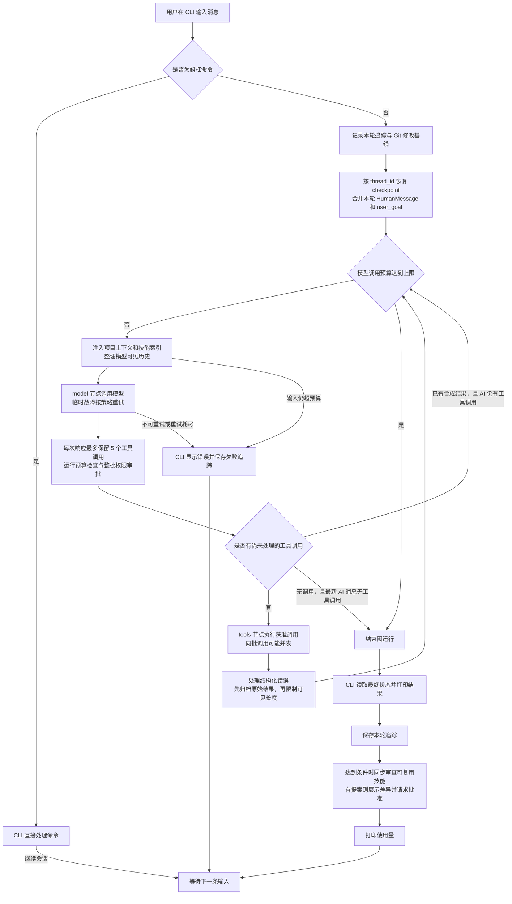
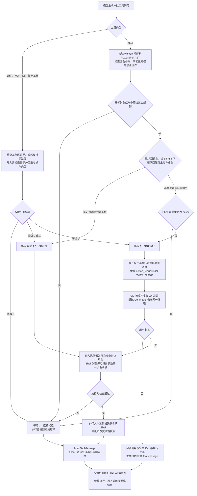
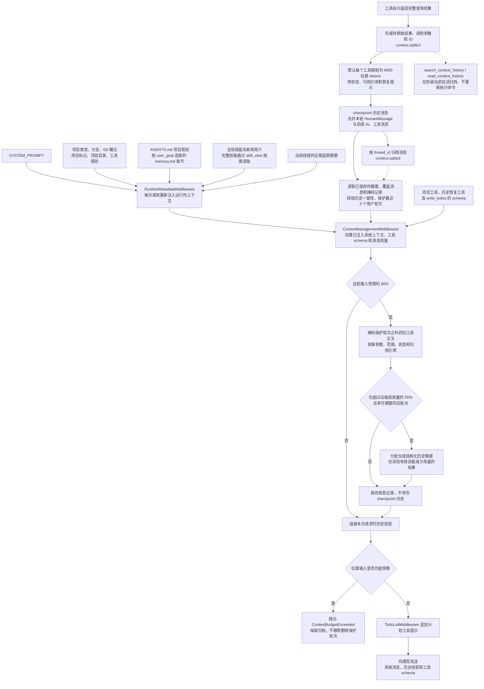

# Code Agent

基于 LangGraph 工具调用构建的命令行编程智能体，以工作区为安全边界。

## 快速开始

在 Windows PowerShell 中，从项目源码安装后启动：

```powershell
python -m venv .venv
.\.venv\Scripts\python.exe -m pip install -e ".[dev]"
.\.venv\Scripts\code-agent.exe .
```

已安装命令并激活对应环境时，也可以直接运行：

```bash
code-agent .
```

CLI 会从所选工作区加载 `.env`，但不会覆盖进程中已有的环境变量。请设置 `DEEPSEEK_API_KEY`，也可以通过 `CODE_AGENT_MODEL` 指定模型；命令行 `--model` 优先，默认模型为 `deepseek-v4-flash`。Shell 执行后端依赖 Windows 和 PowerShell。

所选工作区就是安全边界。默认情况下，`code-agent .` 使用当前工作目录。也可以显式指定项目目录，例如 `code-agent C:\path\to\project`。

## 图执行流程



核心循环由 `src/code_agent/graph.py` 中的 `create_agent()` 生成，实际核心节点为 `model` 和 `tools`；图中将中间件生命周期合并为功能阶段。主模型决定检查文件、修改代码、执行命令还是直接回答，宿主负责上下文、调用限制、审批、工具执行和审计。正常结束条件是最新 AI 消息没有工具调用；当前没有独立的任务验收节点。

CLI 使用 SQLite checkpointer 按 `thread_id` 保存和恢复会话，并以 `stream_mode="updates"` 展示节点更新和工具概要；最终正文在图运行结束后打印。摘要模型和结束后的技能审查属于额外模型调用。

`/help`、`/diff`、`/doctor`、`/tools`、`/resume` 和 `/undo` 等斜杠命令由 CLI 在图运行前处理。

## 权限等级

- 等级 0：只读工具，例如 `list_files`、`read_file`、`search_text`、`git_status` 和 `git_diff`。
- 等级 1：工作区内的低风险修改。
- 等级 2：需要用户审批，例如修改包元数据、删除文件、覆盖整个文件，或在常规项目目录之外新建文件。常规目录包括 `src/`、`tests/`、`test/`、`app/`、`server/`、`client/`、`frontend/`、`backend/` 和 `docs/`；普通局部修改不会仅因位于这些目录之外就要求审批。
- 等级 3：拒绝访问敏感或排除路径，例如 `.env`、`.ssh` 和 `.git`。

## 人工审批

权限审批策略如下。文件操作通过路径和操作类型分类；Shell 先解析整条命令的 PowerShell AST，再应用宿主审批策略。



`--allow-shell` 的豁免仅适用于 `on-risk` 下符合条件的精确命令；显式删除、动态脚本和硬性禁止规则不会因此放行。`untrusted` 不使用此豁免；`never` 将原本需要审批的 Shell 命令直接拒绝。这些审批策略属于 Shell 配置，文件工具仍按文件权限等级处理。

等级 2 的工具调用遵循 LangChain/LangGraph 的人工介入流程：

1. 模型生成工具调用后，图会先检查整批调用，再执行任何工具。
2. 如果有调用需要审批，`ShellApprovalMiddleware` 在模型响应后的审批阶段中断执行，并在同一个载荷中提供所有待处理调用的 `action_requests` 及对应的 `review_configs`。
3. CLI 使用顺序一致的 `decisions` 列表恢复执行。协议支持 `approve`（批准）、`edit`（修改）、`reject`（拒绝）或 `respond`（直接回应）；当前 CLI 的 `y/n` 界面只提交批准或拒绝。
4. 获准或修改后的调用会执行，并生成仅包含工具结果的正常 `ToolMessage`。
5. 被拒绝或直接回应的调用会各自生成一条合成的 `ToolMessage`，与对应的工具调用匹配。
6. 智能体从恢复后的状态继续运行。当前框架保留被拒绝或直接回应的调用，并用相同调用 ID 的合成结果标记其已经处理；即使整批调用都被拒绝，也会再次进入模型循环，且不会执行这些被拒绝的工具。

审批协议数据不会追加到 `messages` 中，只存在于中断载荷和恢复值中。

## 上下文组装

每次模型调用都重新组装运行时上下文，并使用当前会话的历史投影。下图区分持久化消息、模型请求投影和工具原文归档。



`AGENTS.md` 按长度预算加载；`.code-agent/memory.md` 按 Markdown 标题拆分并建立 SQLite 索引，当前按词项、标题和完整查询命中评分选取相关章节。旧的消息数量限制不再触发摘要，摘要也不保存到 `state.context_summary`：摘要与掩码记录保存在 `context.sqlite3` 的投影中，仅覆盖本次模型请求的消息列表。

token 统计使用估算值；按当前中间件顺序，统计发生在 `TodoListMiddleware` 追加计划提示之前，因此不等于最终请求的服务商精确 token 数。压缩预算和历史恢复工具的详细说明见下方“会话上下文管理”。

## 可靠性控制

每次模型响应在到达工具执行器之前，最多保留 5 个工具调用。超出的调用会被省略，并附上运行程序的说明，让模型在后续响应中继续剩余工作。单次图运行默认另有 80 次工具调用预算和 30 次主循环模型调用预算：超预算工具调用会得到合成错误结果，模型仍可继续收尾；模型调用达到上限后，图以限制提示结束。模型请求重试、摘要和技能审查不是此模型调用计数中的独立主循环步。

模型遇到超时、连接错误、HTTP 408/409/425/429 或 HTTP 5xx 等临时故障时，默认最多采用指数退避和随机抖动重试两次。认证失败、校验失败及其他非临时故障不会重试。设置不同的 `CODE_AGENT_FALLBACK_MODEL` 后，主模型临时故障重试结束且时间窗口尚未耗尽时，会使用另一个 DeepSeek 模型进行一次备用尝试。

主循环和摘要模型默认每次 API 请求的超时时间为 120 秒。主循环重试时间窗口为 390 秒，用于判断是否启动下一次重试或备用尝试；它不是整个任务的硬截止时间，也不会中途取消已经发出的请求。主循环和摘要模型的底层客户端自动重试已禁用；主循环由中间件控制重试，技能审查单独使用客户端 `max_retries=1`。可通过以下配置调整这些参数：

- `CODE_AGENT_MODEL_REQUEST_TIMEOUT_SECONDS`
- `CODE_AGENT_MODEL_TOTAL_TIMEOUT_SECONDS`
- `CODE_AGENT_MODEL_MAX_RETRIES`

实际进入工具执行包装器的失败会以可读的 `ToolMessage` 返回，同时作为结构化 `AgentError` 记录到图状态和轮次追踪中。结构化记录包含来源、类别、稳定错误码、是否可重试、尝试次数、调用 ID，以及进程退出码等详细信息。审批拒绝和调用限制产生的合成结果不经过该包装器，不能据此假定每条错误消息都有结构化 `AgentError`。工具错误中间件不会自动重试工具。

## 全局技能

Code Agent 可以在所有工作区之间复用技能库。默认情况下，技能保存在 Code Agent 自身的项目目录中，而不是正在编辑的工作区中：

```text
<code-agent-project>/.code-agent/skills/<skill-name>/SKILL.md
```

可通过 `CODE_AGENT_HOME`、`CODE_AGENT_SKILLS_DIR` 或 `CODE_AGENT_PENDING_SKILLS_DIR` 覆盖这些位置。若安装后的代码路径无法定位源码项目根目录，默认状态目录回退到 `~/.code-agent`。旧版本保存在 `~/.code-agent/pending/skills` 下的待处理变更仍可读取，并可批准或拒绝。

每一轮都会将精简的全局技能索引注入运行时元数据。模型可以调用 `skills_list` 和 `skill_view` 按需加载相关技能。

当一轮工作使用了较多工具、涉及写入、错误或用户纠正等情况时，CLI 会在打印最终回答后同步调用审查模型，判断是否有值得长期保存的操作知识。审查依据是结构化轮次追踪，而非压缩后的会话状态，因此工具调用、执行结果、文件变更、错误、验证、最终回答及已有技能都可供审计。发现有价值的技能后，CLI 会像工具审批一样展示变更建议：打印差异，询问 `y/n`，仅在批准后写入技能；审查结束后才返回下一次输入提示。可使用以下命令：

```text
/skills list
/skills path
/skills view <name>
```

为兼容旧的本地数据，仍支持以下待处理提案命令：

```text
/skills pending
/skills diff <id>
/skills approve <id>
/skills reject <id>
```

自动提案仅接受置信度至少为 0.85 的全局技能；除用户明确请求创建或更新技能外，还要求至少两个独立任务的重复流程及相应证据。当前审查提示中的项目追踪 JSON 有字符长度限制，并不保证发送全部保留轮次的完整内容。

## 轮次追踪

智能体每一轮都会向项目本地的 SQLite 追踪数据库追加一条审计记录：

```text
.code-agent/traces.sqlite3
```

追踪数据库属于本地状态。Code Agent 会写入 `.code-agent/.gitignore`；如果工作区是 Git 仓库，还会将 `.code-agent/` 加入 `.git/info/exclude`，以避免追踪记录和检查点进入项目 Git 历史。技能审查会读取项目追踪记录，从而了解跨轮次的用户反馈和纠正。

根目录 `.gitignore` 也排除运行数据库及其伴随文件、追踪镜像和撤销快照。忽略规则不会自动取消已经跟踪的文件；本仓库不再跟踪本地 checkpoint 数据库，技能文件仍可独立维护。自动写入 `.git/info/exclude` 的逻辑只处理普通 `.git` 目录，Git worktree 应另行维护忽略规则。

随着项目追踪记录增长，审查使用的数据范围会受到限制：结构化历史摘要加上最近的原始轮次记录。最近 100 轮保留完整载荷，更早的轮次则由聚合摘要表示。已有的 `.code-agent/traces/project_trace.json` 文件会被导入一次，并保留为旧版备份。

程序还会自动刷新一份大小受限、便于人工阅读的镜像文件：

```text
.code-agent/traces/project_trace.readable.json
```

其中包含聚合摘要和最近 20 轮的完整记录。在 CLI 中使用 `/trace` 或 `/trace 10`，可查看精简的近期轮次记录及镜像文件路径。

追踪中的工具结果、最终回答等字段有各自的长度限制；需要恢复完整工具原文时使用 `context.sqlite3` 归档。`validation` 字段当前取最后一次 `git_status` 或 `git_diff` 的结果；测试命令输出保存在 Shell 工具追踪中，不能把该字段当作测试通过证明。

## 撤销修改

`/undo` 仅作用于智能体最近一轮的修改。每轮开始时会记录 Git 中已有未提交改动的路径，并跟踪智能体实际修改的文件。

如果智能体修改的文件在本轮开始前就有未提交改动，Code Agent 会在 `.code-agent/undo/<turn-id>/` 下保存修改前的私有快照，撤销时恢复该快照。对于本轮开始时干净的文件，撤销使用 Git 恢复；对于智能体新建的文件，撤销只删除这些文件。

撤销前 CLI 会请求确认；已有改动但缺少快照的路径会被跳过。它依据最近一轮追踪处理文件，不支持区分同一路径上本轮结束后新增的手工修改，撤销前应检查范围和当前差异。

## 工具

模型可以调用受限的文件系统、搜索、Git、技能和 Windows PowerShell 工具。`read_file` 默认只返回有限范围的文本；智能体需要指定后续的 `start_line` 才能继续读取。

`shell_command` 采用三种执行决策：明确允许的操作直接执行；删除、安装、任意脚本等需要审批；已识别的越界、敏感路径和禁止操作直接拒绝。PowerShell AST 解析器会检查复合命令，而不是只匹配第一个命令名。解析失败时拒绝执行。

沙箱模式与审批策略彼此独立，默认 `workspace-write + on-risk`。不再要求先以只读模式执行失败，也不再提供 `danger-full-access` 重试。审批只允许本次具体操作，不改变沙箱权限；批准后修改命令仍会重新检查硬性禁止规则。

```powershell
# 默认：已识别读取直接运行，其余未授权命令审批
code-agent .

# 明确信任当前项目的两个开发入口，避免反复审批
code-agent . --allow-shell 'npm run build' --allow-shell 'npm test'

# Shell 工作区只读；需要审批的 Shell 命令直接拒绝
code-agent . --sandbox-mode read-only --approval-policy never

# 不采用项目命令豁免，只让已识别的读取操作自动执行
code-agent . --approval-policy untrusted
```

`--allow-shell` 精确匹配整条命令，仅在本次 CLI 会话中有效；明确删除命令、动态脚本和禁止路径不会因此放行。它表示用户信任项目代码，**不表示已证明构建/测试脚本安全**。不要把未知项目的执行入口加入允许列表。模式和规则由宿主配置，不从 Agent 可写的项目规则文件加载。

文件工具拒绝修改 `.git`、`.agents`、`.codex`、`.code-agent`。Shell 静态检查保守地拒绝显式访问这些路径，以及 `.env`、私钥等敏感路径。Windows 后端在执行前给已存在的受保护路径添加针对沙箱 SID 的拒绝写入/删除 ACE，并限制父目录删除子项的权限；普通宿主进程不持有这个 SID。发现链接或 junction 时拒绝初始化，避免修改链接目标的 ACL。能力 ACL 会保留在工作区中。

`--sandbox-mode read-only` 只控制 Shell 进程的工作区写约束，当前文件工具没有据此禁用写入，仍按上述文件权限等级执行；不能把此参数视为整个 Agent 的只读开关。

每次调用启动新的 PowerShell 进程，显式定位到 `workdir`。临时目录在两种模式下均可写，npm、uv、pip 缓存重定向到本次临时目录；执行结束后清理。超时和 Job Object 继续负责清理子进程。沙箱初始化失败时拒绝执行，不回退到无约束进程。输出中的权限关键词只用于诊断，不再赋予提权重试资格。

**现有 Windows 后端仍是部分写入隔离。** 它保留 `WRITE_RESTRICTED` 令牌：动态脚本的读取行为和网络访问没有完整的操作系统隔离；Windows 对 Everyone 等主体开放写入的对象以及硬链接仍有平台限制。敏感路径读取的静态检查不能看透任意 Python/Node 脚本；未来在执行中创建的敏感路径也不是通配符 ACL 保护。批准任意脚本不能被理解为安全证明。`read-only` 指工作区写约束，允许本次私有临时目录写入。真正的完整读取/网络隔离需要专用低权限用户或独立隔离后端。

验证：`python -m pytest`；Windows 原生访问测试使用临时工作区及模拟普通项目的 ACL，覆盖普通写入、保护路径写入/删除、工作区外写入、只读写入拒绝。若测试运行器自身被外层沙箱限制，需从正常 Windows 用户终端运行原生测试。

## 常用命令

```text
/doctor
/tools
/diff
/undo
/sessions
/trace [n]
/resume [thread-id]
/help
```

在正在运行的 CLI 会话中，`/sessions` 会列出工作区已保存的会话线程。`/resume` 会列出已保存的线程，并提示输入线程 ID、唯一前缀或列表序号；`/resume [thread-id]` 则直接切换到指定线程。

## 会话上下文管理

实际经过工具执行包装器的调用完成后，先将完整返回结果、参数和调用 ID 保存到 `.code-agent/context.sqlite3`，再限制模型可见输出；超长结果保留开头及退出码/超时信息，附归档引用和恢复提示。审批拒绝、调用限制等合成结果不走这条工具包装链，会作为会话消息归档。工具内部的旧字符截断在包装执行范围内关闭，读取行数、搜索条数等查询范围限制仍然有效：归档保存本次查询的完整结果，不会额外读取整个文件。归档按会话隔离，追加保存原始消息，不随摘要删除。

每次模型请求（包括同一轮内的工具循环）都计入动态系统上下文、工具 schema 和消息的 token 估算。默认达到可用输入预算的 80% 时，优先掩码旧的读取、搜索、Git 和 shell 正文，保留调用关系、操作参数、返回范围、大小、状态和恢复入口。只有掩码后仍超过本次压缩前用量的 50%，才调用模型生成结构化摘要。摘要保存目标、约束、决策、修改、验证、未解决问题、下一步和证据引用。最近 3 个完整用户轮次（包含其工具链）不掩码、不摘要；单工具入口截断仍适用。

摘要/掩码只用于模型请求投影，不改写原始 checkpoint 消息。投影单独持久化，恢复会话后继续使用；若摘要覆盖的消息已不存在、内容改变，或进入受保护轮次，旧投影会失效。摘要失败或过大不覆盖旧摘要；最终输入仍超预算时明确报错，不静默删除受保护轮次。归档不自动裁剪，需要自行管理磁盘用量。

可通过 `AgentConfig` 调整：

| 字段 | 默认值 | 含义 |
| --- | --- | --- |
| `context_token_limit` | 84000 | 可用输入预算，配置时自行扣除模型输出预留 |
| `context_trigger_ratio` | 0.8 | 开始压缩的比例 |
| `context_mask_target_ratio` | 0.5 | 相对本次压缩前大小的目标，不是模型窗口比例 |
| `context_keep_recent_turns` | 3 | 保留完整用户轮次 |
| `context_tool_token_limit` | 4000 | 每个工具可见结果预算，包含截断提示 |
| `context_summary_input_tokens` | 12000 | 每批摘要历史片段预算 |
| `context_summary_token_limit` | 3000 | 摘要结果预算 |

使用 UTF-8 字节数 / 3 的 token 估算，并为消息封装保留开销，不等于服务商精确 tokenizer。旧的 `context_message_limit` / `context_keep_recent` 字段为兼容保留，不再触发摘要。图内工具输出使用新的 token 预算；工具单独调用仍保留原字符限制。

模型可调用 `search_context_history(query, ref?)` 按字面量查找归档内容，再用 `read_context_history(ref, offset_chars, limit_chars)` 按字符范围读取（最多 12000 字符）。这些工具只读取当前会话的归档，不重新执行 shell。定位当前源码仍优先 `search_text`，再 `read_file` 读取局部。结构化摘要使用同配置模型的 JSON 模式并关闭 thinking。

CLI 使用量显示另按消息字符数估算上下文，未包含系统消息和工具 schema，也未使用请求投影；它与上下文管理的预算估算不同。当前压缩次数统计仍识别旧的 `SummarizationMiddleware` 更新，不反映 `ContextManagementMiddleware` 的实际摘要或掩码次数。
